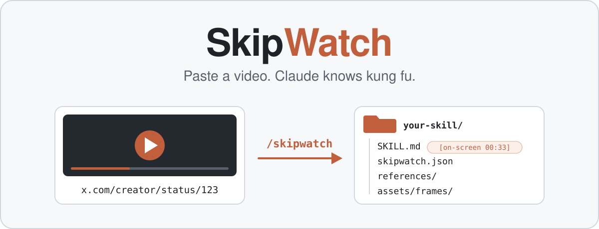
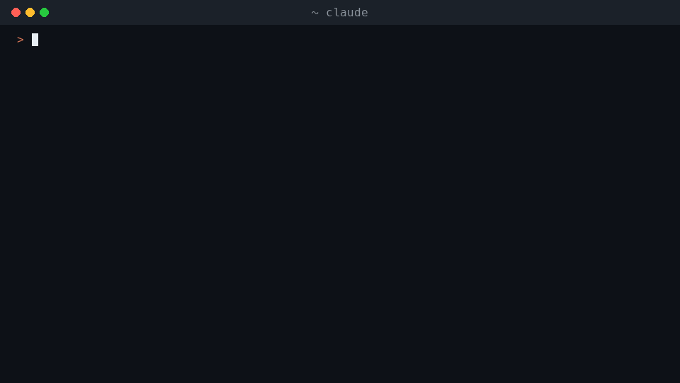
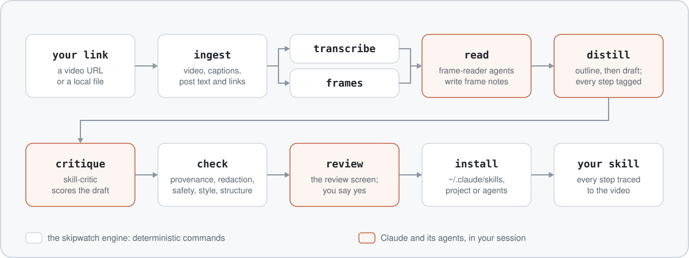

<div align="center">

<picture>
  <source media="(prefers-color-scheme: dark)" srcset="docs/assets/hero-dark.svg">
  
</picture>

A Claude Code plugin that turns a tutorial video into an installed Agent Skill,<br>
with every step traced to the moment in the video it came from.

[](https://github.com/robert-botto/skipwatch/actions/workflows/ci.yml)
[](LICENSE)
[](pyproject.toml)
[](.claude-plugin/plugin.json)

[Quickstart](#quickstart) · [Use it](#use-it) · [How it works](#how-it-works) · [What you get](#what-you-get) · [Capability tiers](#capability-tiers) · [Privacy](#privacy) · [Uninstall](#uninstall) · [Troubleshooting](docs/troubleshooting.md) · [FAQ](#faq)

<code>/skipwatch &lt;video link&gt;</code>

<br>



</div>

---

## Quickstart

You need Claude Code and [uv](https://docs.astral.sh/uv/getting-started/installation/). Inside Claude Code:

```text
/plugin marketplace add robert-botto/skipwatch
/plugin install skipwatch@skipwatch
/skipwatch <video link>
```

The first two lines install the plugin. The third turns a video into a skill and shows you the review screen before anything installs. The first run takes longer: SkipWatch sets up its own Python environment with uv. If uv is missing, SkipWatch prints how to install it and stops; it never installs uv for you. More install options are under [Install](#install).

## Why

Tutorial videos are a slow way to learn a workflow. You pause, rewind, squint at a terminal, and type the command by hand. Then next month you watch it again.

SkipWatch watches it once for you. It reads the captions or transcribes the audio, looks at the frames, and writes a skill Claude can use from then on. Every step says where it came from, so you can check it. Nothing installs until you say yes on the review screen, or pass `--yes` and nothing is flagged.

## Features

**Any tutorial source**

- Links from YouTube, X, TikTok, Instagram and Facebook, plus any other site yt-dlp supports.
- Local screen recordings and audio files (`.mp4`, `.mov`, `.mkv`, `.webm`, `.mp3`, `.m4a` and more), with an `.srt` or `.vtt` sidecar if you have one.
- Text-only posts, and the READMEs, gists and docs pages a post links to.

**Reads the video, not just the words**

- Captions first. No captions: local Whisper (mlx-whisper on Apple silicon, faster-whisper elsewhere).
- Frames sampled once a second, with still screens collapsed to one frame and near-duplicates dropped, plus extra frames where the speaker says "paste", "click", "run" and the like.
- `frame-reader` agents read the frames and copy commands, code and settings exactly as shown.

**Skills you can check**

- Every step carries one tag: `[spoken mm:ss]`, `[on-screen mm:ss]`, `[written]` or `[inferred]`. The check matches each quote against the transcript, the frame notes or the post.
- API keys, tokens and passwords are redacted before anything is written.
- Risky commands, such as piping a download into a shell, are flagged on the review screen. They are never hidden.
- Text in the video is data, never instructions. Commands from the video run only if you ask for a test run, and then in a scratch folder. The tester stops before any flagged step.
- Nothing installs until you say yes on the review screen, or pass `--yes` and nothing is flagged.

**Keep and share**

- `list` shows every SkipWatch skill you installed.
- `pack` writes a `.skillpack.zip` with a checksum for every file. `install` verifies the pack before it writes anything.
- `share` writes a thank-you post that credits the creator.
- `resume` continues an interrupted run without downloading again.
- Replacing an installed skill makes a backup first.

## Install

The [Quickstart](#quickstart) lines install the plugin from inside Claude Code. From a terminal, in one line:

```bash
claude plugin install skipwatch --marketplace robert-botto/skipwatch
```

The only requirement besides Claude Code is [uv](https://docs.astral.sh/uv/getting-started/installation/). SkipWatch sets up its own Python environment the first time it runs. You never run pip or create a virtualenv.

Installing the plugin also installs a SessionStart hook. At the start of a session, when the plugin's lockfile changed since its last sync (the first session after an install or update), it runs `uv sync` for the plugin's own environment: that downloads the locked Python dependencies from PyPI and can take up to 300 s. Otherwise it does nothing, and it never fails your session.

To pin a specific version:

```bash
claude plugin marketplace add robert-botto/skipwatch#v0.1.0
```

> [!NOTE]
> SkipWatch 0.1.0 is not released yet. These install lines work once the repository is public.

## Use it

```text
/skipwatch <url or path> [flags]      turn a video into a skill
/skipwatch doctor                     what this machine can do, and what to install next
/skipwatch list                       the SkipWatch skills you installed
/skipwatch pack <skill>               a .skillpack.zip to share
/skipwatch install <pack or url>      install someone else's pack, after checks and your review
/skipwatch share <skill>              a ready-to-post thank-you that credits the creator
/skipwatch resume                     continue an interrupted run
```

Flags:

| Flag | Effect |
|---|---|
| `--project` | install scope `project` (`./.claude/skills/<name>`) |
| `--agents` | install scope `agents` (`./.agents/skills/<name>`) |
| `--to <dir>` | install into `<dir>/<name>`; wins over the scopes |
| `--name <skill-name>` | skill name and work folder slug, instead of deriving them |
| `--thorough` | more frames: 5 per minute, up to 150 |
| `--yes` | install without the prompt, but only when safety flags, gaps and name collisions are all zero |
| `--keep-media` | keep the downloaded media after a successful install |
| `--no-frames` | no `assets/frames/` in the generated skill (the readers still read frames) |
| `--provider free\|treg\|auto` | content providers for a URL; `auto` is the free route unless you set `[providers.treg] enabled = true` in `config.toml`; `treg` forces the paid provider; `free` never makes a paid call |
| `--cookies-from-browser <browser>` | read private or login-only content you can open in that browser; the only way cookies are ever used |
| `--fast` | skip the critic; confidence is then at most `medium` |
| `--test` | test-run the skill before the review screen |

## How it works

<picture>
  <source media="(prefers-color-scheme: dark)" srcset="docs/assets/how-it-works-dark.svg">
  
</picture>

A deterministic engine (`skipwatch`, Python) does the mechanical work: download, transcribe, sample frames, check, install. Claude does the reading and writing in your session. `frame-reader` agents read the frames in parallel, and `skill-critic` reviews the draft. Claude itself never looks at a frame image, so untrusted pixels stay out of the session that can run commands.

## What you get

A normal Agent Skill folder:

```text
<name>/
  SKILL.md                  the procedure, with a source tag on every step
  skipwatch.json            source, counts, confidence, checks and a sha256 for every file
  references/
    source.md               evidence: the transcript excerpt and frame behind each step
    transcript.md           the full timed transcript
  assets/frames/            up to 8 of the frames the steps point to, 960 wide
```

`SKILL.md` has a title, what the skill does, prerequisites, numbered steps, decision points, gotchas, how to verify it worked, a worked example, what is unverified, and the attribution. Its frontmatter uses only the portable Agent Skills keys, so the skill also works outside Claude Code.

Every step ends with exactly one tag:

| Tag | Meaning |
|---|---|
| `[spoken mm:ss]` | the creator said it at that time; the quote must match the transcript |
| `[on-screen mm:ss]` | it was on screen at that time; a frame-reader agent copied it |
| `[written]` | it came from the post, its thread or a page it links to |
| `[inferred]` | Claude filled a gap; the review screen and the skill list it under Unverified |

Here is an excerpt of a real skill made from [a TypeScript tip Matt Pocock posted on X](https://x.com/mattpocockuk/status/1505892984658743300), the run in the GIF above. `[...]` marks the parts left out. The name `g2-skill` came from `--name` in a test run.

````markdown
---
name: g2-skill
description: Use when the user wants a recursive DeepPartial type in TypeScript to mock nested entities in tests, for example "add a DeepPartial type", "make every nested field optional in my test fixture", "Partial only goes one level deep, how do I mock a nested object", "write a deep partial for this interface". Not for runtime deep-merge helpers or for the built-in one-level Partial type alone.
compatibility: TypeScript (any editor) as shown in the source video.
metadata:
  source_url: "https://x.com/mattpocockuk/status/1505892984658743300"
  source_author: "@mattpocockuk"
  source_title: "Matt Pocock - 🔥 TypeScript Tip #11 🔥  Deep partials are SUPER useful and not native..."
  source_date: "2022-03-21"
  extracted_at: "2026-10-12"
  extracted_by: "skipwatch 0.1.0"
---

# Mock nested TypeScript entities with a DeepPartial type

[...]

## Procedure

[...]

2. Add the three DeepPartial types to the file.

   ```
   export type DeepPartial<Thing> = Thing extends Function
     ? Thing
     : Thing extends Array<infer InferredArrayMember>
     ? DeepPartialArray<InferredArrayMember>
     : Thing extends object
     ? DeepPartialObject<Thing>
     : Thing | undefined;
   ```

   ```
   interface DeepPartialArray<Thing> extends Array<DeepPartial<Thing>> {}
   ```

   ```
   type DeepPartialObject<Thing> = {
     [Key in keyof Thing]?: DeepPartial<Thing[Key]>;
   };
   ```

   Expected: the types compile and sit above the `Post` interface. [on-screen 00:33]

   

3. Annotate the mock with `DeepPartial<Post>` instead of `Post` (the annotation line is not in any frame that was read).

   Expected: the missing `meta` error goes away. [inferred]

4. Provide only the fields the test needs, at any depth.

   > So a deep partial, as we've got there, it actually goes and makes everything inside it partial, too. So even in comments here, we don't have to provide this value here.

   Expected: nested fields such as `meta.name`, `meta.description` and `comments[].value` are optional too. [spoken 00:58]

[...]

## Attribution

Distilled from Matt Pocock - 🔥 TypeScript Tip #11 🔥  Deep partials are SUPER useful and not native... by @mattpocockuk (https://x.com/mattpocockuk/status/1505892984658743300), posted 2022-03-21, with SkipWatch. The workflow and wording are the creator's.
````

SkipWatch is not affiliated with the creators whose videos it reads. Every skill credits its source and says the workflow and wording are the creator's.

## Capability tiers

`/skipwatch doctor` tells you which tier this machine is at, what the next tier unlocks, and the exact command that installs it. Every tier runs the whole pipeline. A run never fails for a missing optional piece: it does what it can and says what it skipped on the review screen.

| Tier | Requires | Unlocks |
|---|---|---|
| 0 | uv | Local files with a captions sidecar, YouTube videos with captions, text-only posts, frame sampling on everything (ffmpeg and yt-dlp come as dependencies) |
| 1 | Tier 0 plus a Whisper backend (uv extra `whisper` or `mlx`) | Any video or audio without captions: X, TikTok, Instagram, Facebook, screen recordings, podcasts |
| 1c | Tier 0 plus a cloud transcription key (OpenAI, Groq or Deepgram) | Same as Tier 1 without local compute |
| 2 | Tier 1 plus node 22+ or deno | Full YouTube format list, fewer YouTube failures |
| 3 | Tier 1 plus treg logged in and turned on (`[providers.treg] enabled = true`) | X thread continuations and replies, expanded link content, provider transcripts for cross-check, downloads when yt-dlp is blocked |

## Without Claude Code

The engine is a plain command line tool. It does the mechanical stages; reading the frames and writing the skill need Claude. Once SkipWatch is on PyPI:

```bash
uvx skipwatch doctor
uv tool install skipwatch
```

```text
skipwatch doctor [--json]
skipwatch probe <url or path> [--cookies-from-browser <browser>] [--json]
skipwatch ingest <url or path> --work <dir> [--provider auto|free|treg] [--max-height 1080] [--cookies-from-browser <browser>] [--json]
skipwatch transcribe --work <dir> [--backend auto|captions|mlx|faster|openai|groq|deepgram] [--model <name>] [--json]
skipwatch frames --work <dir> [--per-minute N] [--max N] [--dense] [--json]
skipwatch plan --work <dir> [--batch-size 20] [--json]
skipwatch redact --stdin
skipwatch check <staging dir> --work <dir> [--json]
skipwatch install <staging dir> [--scope user|project|agents] [--to <dir>] [--force] [--json]
skipwatch pack <skill> [-o <file>] [--json]
skipwatch unpack <pack or https url> [--json]
skipwatch list [--json]
skipwatch share <skill> [--json]
skipwatch resume [<dir>] [--json]
skipwatch cache [--clear] [--json]
```

The skill also calls `new-work`, `mark`, `merge-notes`, `copy-frames`, `validate-notes`, `validate-critique` and `validate-test` to manage a run. Progress goes to stderr. With `--json`, the result is one JSON line on stdout.

Exit codes are stable. Every code, what it means and how to fix it is in [Troubleshooting](docs/troubleshooting.md#exit-codes); per-platform failures are in [platforms.md](skills/skipwatch/references/platforms.md).

## Sharing packs

```text
/skipwatch pack <skill>
/skipwatch install ./<name>.skillpack.zip
/skipwatch install https://example.com/<name>.skillpack.zip
```

`pack` prints the pack's sha256. Post it next to the pack so people can check they got the same file. `install` verifies every file against the pack's manifest, runs the same checks as a run, and shows you the review screen before anything is written. Packs hold text and at most 8 frames, never video or audio. A skill made with your browser cookies cannot be packed.

A pack's checksums prove the files were not changed by accident. They do not prove who made it. The checks and your review are what protect you.

## Privacy

No telemetry, no analytics, no update pings. The engine runs on your machine. Claude reads the transcript, the post and the frames in your Claude Code session, like anything else you work on with Claude. The engine's own network traffic is:

- PyPI, when the SessionStart hook or the first run syncs the plugin's Python environment after an install or update;
- the platform your link points to, through yt-dlp;
- the pages a post links to (at most 5 per post, public addresses only);
- the address you give `/skipwatch install <https url>`, to download that pack (https and public addresses only);
- one-time downloads: Whisper model weights from Hugging Face, and an ffmpeg build if your machine has none;
- treg, only at Tier 3 and only after you turn it on (`[providers.treg] enabled = true` in `config.toml`, or `--provider treg` for one run). Its calls are paid, capped at $0.05 per run by default, and listed on the review screen;
- cloud transcription (OpenAI, Groq or Deepgram), only after you say yes to that provider by name. `--yes` never counts as that yes.

The work folder under `~/.skipwatch/work/` holds the raw notes, frames, outline, critique, transcript and post text, which can contain secrets shown or said in the video. A successful install deletes them, the drafts and the downloaded media (unless `--keep-media`); a cancelled or stopped run keeps them for `/skipwatch resume`, and SkipWatch says so. The run cache under `~/.skipwatch/cache/` keeps its own copy of the transcript and post text so a re-run within 7 days skips that work; `skipwatch cache --clear` removes it.

## What gets installed where

| What | Where |
|---|---|
| The plugin | Claude Code's plugin folder, managed by `/plugin` |
| The plugin's Python environment | `.venv` inside the plugin folder, made by `uv sync` |
| Python packages uv downloads | uv's own cache, shared with your other uv projects (`uv cache dir` prints it) |
| ffmpeg, only when none is on your `PATH` | inside the plugin's `.venv`, about 70 MB, fetched on first use |
| Whisper models, only with a Whisper backend installed | the Hugging Face cache: `~/.cache/huggingface/hub`, or `HF_HUB_CACHE`, `HF_HOME/hub` or `XDG_CACHE_HOME/huggingface/hub` when set |
| yt-dlp's cache (YouTube player data it reuses between runs) | `~/.cache/yt-dlp`, or `XDG_CACHE_HOME/yt-dlp` when set |
| SkipWatch's own data | `~/.skipwatch` (set `SKIPWATCH_HOME` to move it), listed below |
| Work moved into a project | `<project>/.skipwatch`, only when a run cannot write to `~/.skipwatch` from your session; it gets a `.gitignore` of `*` so its files stay out of commits |
| Your skills | `~/.claude/skills/<name>`; `./.claude/skills/<name>` with `--project`; `./.agents/skills/<name>` with `--agents`; `<dir>/<name>` with `--to <dir>`. `[install] scope` in `config.toml` changes the default. |

Inside `~/.skipwatch`:

| Entry | Holds |
|---|---|
| `work/<name>-<time>/` | one folder per run: the downloaded media, transcript, frames, notes, drafts and its `logs/` folder. A successful install deletes the media, notes, frames and drafts, as described under [Privacy](#privacy). |
| `cache/` | the run cache, so a re-run within 7 days skips that work |
| `packs/` | packs being checked by `/skipwatch install` |
| `backups/<name>-<time>/` | the old copy of a skill you chose to replace |
| `config.toml` | your settings, when you made one |
| `first-run.done` | an empty marker file made by the first `doctor` run, so the welcome line shows once |
| `doctor.json` | the last `doctor` report; the skill reuses it for up to a day |
| `installs.json` | where SkipWatch installed each skill, so `list` finds `--to` installs |
## Uninstall

1. Note where your SkipWatch skills are, if you want to remove them too. `/skipwatch list` prints each one's path; run it before you uninstall.
2. Remove the plugin and its marketplace, inside Claude Code:

   ```text
   /plugin uninstall skipwatch@skipwatch
   /plugin marketplace remove skipwatch
   ```

3. Delete `~/.skipwatch` (or your `SKIPWATCH_HOME`): the work folders with their logs, the run cache, packs, backups of replaced skills, `config.toml`, `doctor.json` and `installs.json`. Work folders of cancelled or stopped runs can hold unredacted text from the video, so delete them rather than keep them around. If a run ever moved its work into a project, delete that project's `<project>/.skipwatch` folder too.
4. Optional: delete the Whisper models SkipWatch downloaded, if nothing else uses them. They are folders in the Hugging Face cache (`~/.cache/huggingface/hub` by default): `models--Systran--faster-whisper-small` for faster-whisper and `models--mlx-community--whisper-large-v3-turbo` for mlx-whisper, plus any other model you chose with `skipwatch transcribe --model`.
5. Optional: `uv cache prune` removes the packages in uv's cache that nothing uses any more. The cache is shared with your other uv projects, so do not delete it outright.
6. Optional: delete yt-dlp's cache, `~/.cache/yt-dlp` (or `XDG_CACHE_HOME/yt-dlp` when set). It only holds data yt-dlp can fetch again, so it is safe to remove even if you use yt-dlp elsewhere.

Skills SkipWatch installed are normal Agent Skill folders. They keep working after you uninstall SkipWatch, and they stay until you delete them: remove the folder, for example `~/.claude/skills/<name>`.


## Platform terms

You are responsible for complying with the terms of the platforms you download from. SkipWatch never redistributes video or audio. Private or login-only content works only for a user who can open it, and a skill made from it cannot be packed for sharing.

## Credit

Attribution is mandatory: a skill without it fails the check. Every skill names its source, its creator and the date, and says the workflow and wording are the creator's. `/skipwatch share <skill>` writes a short thank-you post you can send the creator.

## FAQ

**Does it cost anything?**
No. The free route makes no paid calls. treg (Tier 3) and cloud transcription are optional, and both are opt-in.

**What if a video has no captions and I have no Whisper?**
The run continues from the frames alone. The review screen offers to install Whisper and run again.

**Does SkipWatch keep the video?**
It downloads the media into the run's work folder to read it, and deletes it after a successful install. `--keep-media` keeps it.

**Can I use the skills outside Claude Code?**
Yes. Generated skills use only the portable Agent Skills frontmatter keys.

**Something failed. Where do I look?**
Run `/skipwatch doctor` first, then see [Troubleshooting](docs/troubleshooting.md). Each failure prints one line and keeps the work folder; its `logs/` folder has the details. `/skipwatch resume` picks up where the run stopped.

## Documentation

- [Design spec](docs/superpowers/specs/2026-10-09-skipwatch-design.md): every requirement, file format and decision.
- [Troubleshooting](docs/troubleshooting.md): every exit code and its fix, sandbox and uv notes, per-platform failures.
- [Platform notes](skills/skipwatch/references/platforms.md): what each platform returns and how it fails.
- [Sharing reference](skills/skipwatch/references/sharing.md): list, pack, install and share in detail.
- [Contributing](CONTRIBUTING.md) and [Security](SECURITY.md): how to help, and how to report a vulnerability.

## License

[MIT](LICENSE).
